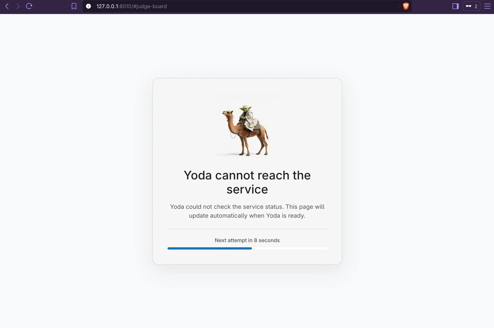

# Troubleshooting

Yoda Web is a static frontend served by nginx. Its data comes from a separate
Yoda API. A page loading at `http://localhost:8080` confirms that nginx is
serving the frontend; it does **not** confirm that the API is reachable.



## Start With The Status Request

1. Open the app in your browser and open Developer Tools (**Network** and
   **Console**). Reload the page and look for a request ending in `/status`.
2. Check the request URL, HTTP status, response body, and any browser error.
   The frontend requests `<BASE_API_URL>/status`. It expects JSON with an API
   status of `ok` and HTTP 200 to show the app; a maintenance response is
   shown separately. It retries its status check every 15 seconds.
3. If the request fails, use the sections below according to its URL. If it
   succeeds but other pages fail, inspect the failing API request in the same
   Network tab; authentication and API errors are separate from connectivity.

The image health check only fetches nginx's `/` page, so a healthy container
can still have an unreachable API.

## Direct Browser Connection

With `BASE_API_URL=http://localhost:8001`, the **browser** connects to port
8001. `localhost` means the browser's machine, not the container. If someone
opens Yoda Web from another computer, `localhost:8001` means *that visitor's*
computer; use an API URL reachable from their browser instead.

Test the API from the browser's machine:

```sh
curl -i http://localhost:8001/status
```

- Connection refused or timeout: verify the API is running and listening on
  an address and port reachable from the browser's machine.
- Browser reports a CORS error while `curl` succeeds: the UI and API are on
  different origins. Configure the API to allow the UI origin (for example,
  `http://localhost:8080`), including the request methods and headers it uses.
  The frontend sends JSON requests and may send an `Authorization` header.
- Mixed-content error: an HTTPS page cannot call an HTTP API in a typical
  browser. Use an HTTPS API endpoint or a suitable same-origin proxy.

## nginx `/llm/` Proxy

Set `LLM_ROUTING_URL` to the OpenAI-compatible provider origin with a trailing
slash (for example, `https://api.openai.com/`). The browser uses the default
`/llm/v1/chat/completions` endpoint in LLM settings and fetches models from
`/llm/v1/models`. nginx strips `/llm/` and forwards both requests, including
the API key's `Authorization` header. The upstream must be reachable from the
container. A 404 usually indicates the upstream URL has the wrong path or a
missing trailing slash. Chat completions are not streamed, so nginx waits for
the provider's complete response; the `/llm/` route allows up to 300 seconds
between upstream reads. A 504 after about five minutes can mean the provider
is still generating; a quicker 502/504 suggests an upstream connection or TLS
issue. If another reverse proxy sits in front of nginx, its timeout may also
need adjustment.

Without `LLM_ROUTING_URL`, use a direct provider endpoint that supports CORS.

## nginx `/api` Proxy

For development, setting `API_ROUTING_URL` adds an nginx proxy for `/api`.
It does not change the frontend's API address: set `BASE_API_URL` to the UI's
`/api` URL as well. For example, with Yoda Web at `http://localhost:8080`,
`BASE_API_URL=http://localhost:8080/api` makes the browser request
`http://localhost:8080/api/status`. nginx forwards it to the URL given by
`API_ROUTING_URL`. The upstream URL must be reachable **from the container**,
not merely from the browser.

Check both sides of the route:

```sh
curl -i http://localhost:8080/api/status
curl -i https://api.example.com/status
```

Replace the second URL with your actual upstream status endpoint. With an
`API_ROUTING_URL` ending in `/`, nginx replaces the `/api` prefix, so
`/api/status` becomes `/status` upstream. Choose the upstream path to match
the backend's actual routes. A 404 often means the prefix or upstream path is
wrong; a 502/504 suggests the container cannot connect to the upstream or
complete the upstream TLS handshake. Inspect container logs with
`docker logs <container>` or `podman logs <container>`.

If the browser instead requests `http://localhost:8001/status`, it is not
using the proxy. Check `BASE_API_URL`, not just `API_ROUTING_URL`. Conversely,
setting only `BASE_API_URL` to `/api` without `API_ROUTING_URL` leaves nginx
without that proxy route.
