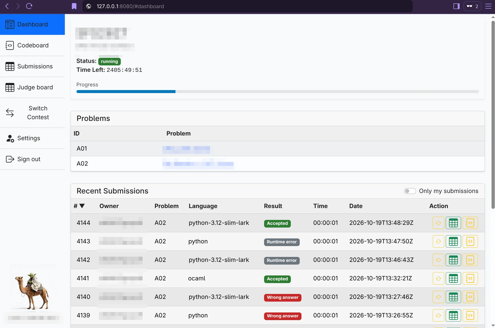

# Yoda Web

[](https://github.com/anmaped/yoda-web/actions/workflows/build-static-package.yml)
[](https://github.com/anmaped/yoda-web/actions/workflows/build-container-image.yml)
[](LICENSE)

[](https://ocaml.org/)
[](https://github.com/ocsigen/js_of_ocaml)
[](https://github.com/ocsigen/tyxml)

Yoda Web (yoda-w) is the browser frontend for the Yoda Backend server (yoda-b). It is written in OCaml, compiled to JavaScript with js_of_ocaml, and rendered using Tyxml_js, which helps produce well-structured HTML.



This repository contains the frontend only. A running Yoda API is required for application data; the `yoda-w` checks the API's `/status` endpoint before showing the application.

## Run the Container Image

Docker or Podman and a separately running Yoda API are required. The easiest option is to use the [published Yoda Web container image](https://github.com/anmaped/yoda-web/pkgs/container/yoda-web).

Docker:

```sh
docker run --rm -p 8080:80 -e BASE_API_URL=http://localhost:8001 ghcr.io/anmaped/yoda-web:latest
```

Podman:

```sh
podman run --rm -p 8080:80 -e BASE_API_URL=http://localhost:8001 ghcr.io/anmaped/yoda-web:latest
```

The container runtime downloads the image automatically if it is not already present. No source checkout or OCaml toolchain is needed to run it.

Open <http://localhost:8080>. Here `localhost:8001` is resolved by the browser, so this example assumes the API is reachable there from the browser and allows requests from `http://localhost:8080`.

The container accepts these settings:

| Setting | Purpose |
| --- | --- |
| `BASE_API_URL` | API origin or same-origin path used by browser requests; the frontend falls back to `http://localhost:8001` if unset. |
| `API_ROUTING_URL` | Optional nginx proxy target for `/api` requests during development; unset disables the proxy. |
| `LLM_ROUTING_URL` | Optional nginx upstream URL for same-origin `/llm/` requests; unset disables the proxy. |

`BASE_API_URL` is obfuscated in the generated HTML, **not encrypted**. Do not put credentials or secrets in it.

For development, `API_ROUTING_URL` adds an nginx `/api` proxy to the specified URL. It does not change where the frontend sends requests; configure `BASE_API_URL` separately if you want the browser to use that proxy. The proxy target must be reachable from the container.

For example, with Podman and an API hosted at `https://api.example.com/`:

```sh
podman run --rm -p 8080:80 -e BASE_API_URL="http://localhost:8080/api" -e API_ROUTING_URL="https://api.example.com/" ghcr.io/anmaped/yoda-web:latest
```

Open <http://localhost:8080>. Browser requests to `/api` go through the container's nginx proxy to the remote API.

For an OpenAI-compatible provider, set `LLM_ROUTING_URL` to its upstream origin with a trailing slash, such as `https://api.openai.com/`. The LLM settings default to `/llm/v1/chat/completions`; model discovery uses `/llm/v1/models`. nginx replaces `/llm/` with the upstream URL's path and forwards the browser's `Authorization` header. For example, `/llm/v1/models` becomes `https://api.openai.com/v1/models`. The upstream must be reachable from the container. Configure the provider API key in LLM settings, not in `LLM_ROUTING_URL`.

```sh
docker run --rm -p 8080:80 -e BASE_API_URL=http://localhost:8001 -e LLM_ROUTING_URL=https://api.openai.com/ ghcr.io/anmaped/yoda-web:latest
```

Without `LLM_ROUTING_URL`, the default `/llm/` endpoint will not work; enter a directly reachable provider URL in LLM settings instead (which requires provider CORS support).

If the Yoda Web cannot reach the API, see the [troubleshooting guide](doc/troubleshooting.md).

## Build From Source

The recommended way to compile the frontend is the [VS Code dev container](.devcontainer/devcontainer.json):

1. Install VS Code, its **Dev Containers** extension, and Docker with a running daemon.

2. Clone the repository:

   ```sh
   git clone https://github.com/anmaped/yoda-web.git
   ```

3. Open the cloned `yoda-web` folder in VS Code.

4. Open the Command Palette (`Ctrl+Shift+P` or `F1`) and select **Dev Containers: Reopen in Container**. When the progress popup appears, click  **Show Log** to follow the setup. Wait for the first-time image build and `postCreateCommand` to finish; it installs the project's opam dependencies.

5. Open a VS Code terminal inside the container (**Terminal > New Terminal**). From the repository root, build the JavaScript bundle:

   ```sh
   opam exec -- dune build src/main.bc.js --profile release
   ```

The dev container provides OCaml 5.2, Dune, and `curl`. The repository is mounted from the host, so the generated `_build/default/src/main.bc.js` is available to host-side Docker or Podman builds. The Dune build needs network access to download frontend assets.

Alternatively, build on the host with OCaml, opam, Dune 3.8 or later, and `curl` installed. Run `opam install ./yoda-web.opam --deps-only` before the Dune command above.

### Package And Run The Build

After the JavaScript build finishes, open a terminal **on your host machine** in the same cloned `yoda-web` folder. If you used the dev container, you can leave VS Code open in it; its bind-mounted workspace makes the `_build` output visible from the host without copying files. The [Containerfile](Containerfile) uses `_build/default/src/main.bc.js` to package the frontend into nginx.

Build and run with Docker:

```sh
docker build -f Containerfile -t yoda-web .
docker run --rm -p 8080:80 -e BASE_API_URL=http://localhost:8001 yoda-web
```

Or with Podman:

```sh
podman build -f Containerfile -t localhost/yoda-web .
podman run --rm -p 8080:80 -e BASE_API_URL=http://localhost:8001 localhost/yoda-web
```

To label a source-built image, pass `--build-arg VERSION=<version>` to `docker build` or `podman build`; it defaults to `dev` and controls the JavaScript filename and HTML version metadata at build time.


## License

This project is licensed under GPL-3.0-only. See [LICENSE](LICENSE) for the full text.
